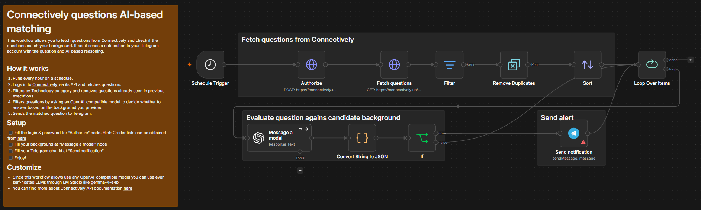
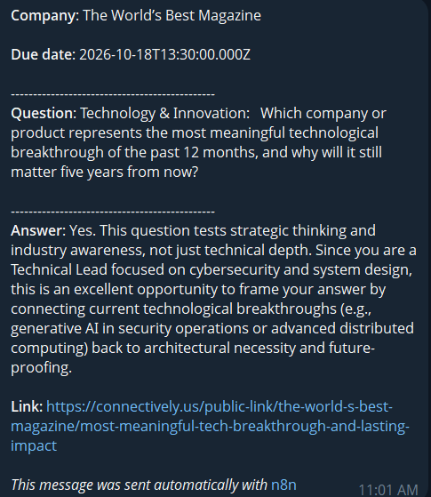
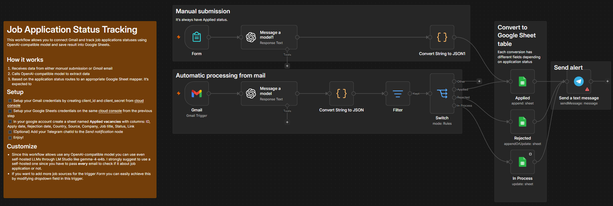
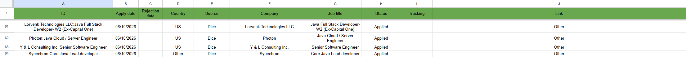

<!-- TOC -->
* [n8n-templates](#n8n-templates)
  * [Connectively AI](#connectively-ai)
      * [Overview](#overview)
      * [Result sample](#result-sample)
  * [Job Application Status Tracking](#job-application-status-tracking)
      * [Overview](#overview-1)
      * [Result sample](#result-sample-1)
<!-- TOC -->

# n8n-templates
This repo contains source of working out-of-the-box n8n workflows.  
Templates:

## Connectively AI
This workflow allows you to fetch questions from [Connectively](https://www.connectively.us/experts/questions) 
and check if the questions match your background. If so, it sends a notification to your Telegram account with the 
question and AI-based reasoning.
#### Overview

#### Result sample

---
## Job Application Status Tracking
This is an enhanced version of the workflow I found once and cannot find to put a link here (unfortunately).
It allows you to connect Gmail and track job applications statuses using OpenAI-compatible model and save result into Google Sheets. 
Important note: while this workflow allows to use any OpenAI-compatible model, I strongly suggest to use a self-hosted one
since you have to pass **every** email to check if it about job application or not.
#### Overview

#### Result sample

---